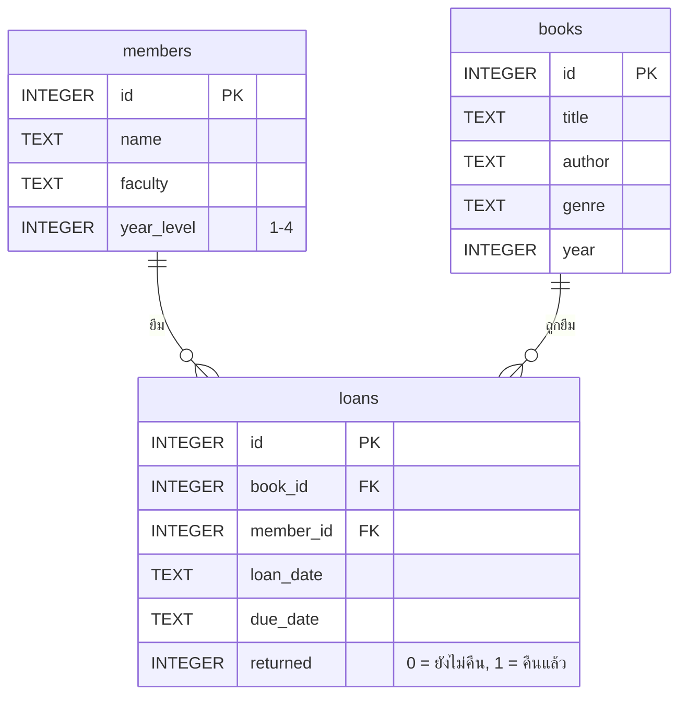

# Book DB — ระบบฐานข้อมูลห้องสมุด

เว็บแอประบบห้องสมุดที่ใช้ฐานข้อมูล **SQLite จริง** ทำงานในเบราว์เซอร์ทั้งหมด ไม่ต้องติดตั้งฐานข้อมูลหรือเซิร์ฟเวอร์เพิ่ม

- ค้นหา ยืม คืน เพิ่มหนังสือ เพิ่มสมาชิก และดูสถิติ ผ่านปุ่มและฟอร์มเหมือนระบบห้องสมุดจริง
- หนังสือแต่ละเล่มบน **ชั้นหนังสือ 3D** คือหนึ่งแถวในตาราง `books` ข้อมูลเปลี่ยน ชั้นก็เปลี่ยนตาม
- ทุกครั้งที่กดปุ่ม แผง **"SQL ที่ทำงานเบื้องหลัง"** จะแสดงคำสั่ง SQL จริงที่ถูกส่งไปยังฐานข้อมูล

---

## 1. สิ่งที่ต้องติดตั้งก่อน (ทำครั้งเดียว)

### Node.js

โปรแกรมนี้ต้องใช้ **Node.js** (มี `npm` มาให้ในตัว)

1. เข้า <https://nodejs.org>
2. ดาวน์โหลดเวอร์ชัน **LTS** แล้วติดตั้งตามขั้นตอนปกติ (กด Next ไปเรื่อย ๆ)
3. **ปิด Terminal แล้วเปิดใหม่** จากนั้นพิมพ์เพื่อตรวจว่าติดตั้งสำเร็จ

```bash
node -v
npm -v
```

ถ้าขึ้นเป็นตัวเลขเวอร์ชัน เช่น `v22.x.x` และ `10.x.x` แปลว่าพร้อมใช้งาน

### Git (ไม่บังคับ)

ถ้าจะดาวน์โหลดโค้ดด้วยคำสั่ง `git clone` ต้องมี Git (<https://git-scm.com>)
ถ้าไม่อยากติดตั้ง ให้ดาวน์โหลดเป็นไฟล์ ZIP แทนได้ (ดูขั้นตอนถัดไป)

---

## 2. วิธีรันโปรแกรม (ทีละขั้น)

### ขั้นที่ 1: ดาวน์โหลดโค้ด

**แบบที่ 1 ใช้ Git**

```bash
git clone https://github.com/Jitwisut/project-db.git
```

**แบบที่ 2 ไม่ใช้ Git**
เปิดหน้า GitHub ของโปรเจกต์ → กดปุ่มสีเขียว **Code** → **Download ZIP** → แตกไฟล์ ZIP

### ขั้นที่ 2: เปิด Terminal แล้วเข้าไปในโฟลเดอร์โปรเจกต์

- **macOS:** เปิดแอป Terminal
- **Windows:** เปิด PowerShell (หรือใน VS Code เลือกเมนู Terminal → New Terminal)

แล้วพิมพ์ `cd` ตามด้วยที่อยู่ของโฟลเดอร์ เช่น

```bash
cd project-db
```

> **สำคัญ:** ต้องอยู่ในโฟลเดอร์ที่มีไฟล์ `package.json`
> ตรวจได้โดยพิมพ์ `ls` (macOS) หรือ `dir` (Windows) แล้วต้องเห็น `package.json` ในรายการ
> ถ้าแตก ZIP ชื่อโฟลเดอร์อาจเป็น `project-db-main`

### ขั้นที่ 3: ติดตั้งแพ็กเกจ (ครั้งแรกครั้งเดียว)

```bash
npm install
```

รอประมาณ 1–2 นาที (ต้องต่ออินเทอร์เน็ต) เสร็จแล้วจะมีโฟลเดอร์ `node_modules` เพิ่มขึ้นมา

### ขั้นที่ 4: รันโปรแกรม

```bash
npm run dev
```

เบราว์เซอร์จะเปิดหน้าเว็บให้อัตโนมัติ ถ้าไม่เปิด ให้ดูใน Terminal จะมีบรรทัด

```
➜  Local:   http://localhost:5173/
```

ให้คัดลอกที่อยู่นั้นไปเปิดในเบราว์เซอร์ (แนะนำ Chrome หรือ Edge)

**หยุดโปรแกรม:** กลับไปที่ Terminal แล้วกด `Ctrl + C`

**รันครั้งต่อไป:** ทำแค่ขั้นที่ 2 (เข้าโฟลเดอร์) และขั้นที่ 4 (`npm run dev`) ไม่ต้อง `npm install` ซ้ำ

---

## 3. ปัญหาที่พบบ่อย

| อาการ | สาเหตุ | วิธีแก้ |
| --- | --- | --- |
| `npm: command not found` หรือ `ไม่รู้จักคำสั่ง npm` | ยังไม่ได้ติดตั้ง Node.js หรือยังไม่ได้เปิด Terminal ใหม่ | ติดตั้ง Node.js (หัวข้อที่ 1) แล้วปิด-เปิด Terminal ใหม่ |
| `npm error enoent Could not read package.json` | รันคำสั่งผิดโฟลเดอร์ | `cd` เข้าโฟลเดอร์ที่มี `package.json` ก่อน (ขั้นที่ 2) |
| `vite: command not found` หรือ `Cannot find module` | ยังไม่ได้ `npm install` | รัน `npm install` ก่อน แล้วค่อย `npm run dev` |
| Terminal บอกว่า port 5173 ถูกใช้อยู่ | มีโปรแกรมอื่นใช้ port นี้ | ไม่เป็นไร โปรแกรมจะเลือก port ถัดไปให้เอง ให้ใช้ที่อยู่ที่แสดงใน Terminal |
| หน้าเว็บขาว หรือไม่เห็นชั้นหนังสือ 3D | เบราว์เซอร์ปิดการเร่งกราฟิก | ใช้ Chrome/Edge เวอร์ชันล่าสุด และเปิด "Use hardware acceleration" ในการตั้งค่า |
| รีเฟรชหน้าแล้วข้อมูลที่เพิ่มหายไป | ฐานข้อมูลอยู่ในหน่วยความจำของเบราว์เซอร์ | เป็นการออกแบบไว้ ข้อมูลจะกลับเป็นข้อมูลตั้งต้นทุกครั้งที่เปิดใหม่ (หรือกด RESET DB) |

---

## 4. วิธีใช้งาน

ไม่ต้องพิมพ์ SQL เอง ใช้งานผ่านเมนูด้านบน แล้วดูคำสั่ง SQL ที่เกิดขึ้นจริงได้ที่แผงมุมขวาล่าง

| เมนู | ทำอะไรได้ | SQL ที่ใช้ |
| --- | --- | --- |
| **ชั้นหนังสือ** | ค้นหาชื่อ/ผู้แต่ง, กรองหมวด, เรียงลำดับ, เพิ่มหนังสือ | `WHERE … LIKE ?`, `WHERE genre = ?`, `ORDER BY`, `INSERT INTO books` |
| **คลิกหนังสือ** | ดูข้อมูลและประวัติการยืม, ยืม, คืน, ลบ | `JOIN`, `INSERT INTO loans`, `UPDATE loans`, `DELETE FROM books` |
| **สมาชิก** | รายชื่อพร้อมจำนวนเล่มที่ยืมอยู่, ดูว่าใครยืมเล่มไหน, เพิ่มสมาชิก | `LEFT JOIN … GROUP BY`, `INSERT INTO members` |
| **ยืม-คืน** | รายการที่ยังไม่คืน, แจ้งเตือนเกินกำหนด (⚠), กดคืน | `JOIN` 3 ตาราง, `date('now')`, `UPDATE loans` |
| **สถิติ** | จำนวนหนังสือแต่ละหมวด, คนที่ยืมบ่อย, หนังสือยอดนิยม | `GROUP BY`, `ORDER BY … LIMIT 3`, `HAVING` |

ในฉาก 3D: ลากเมาส์เพื่อหมุน, scroll เพื่อซูม, คลิกหนังสือเพื่อเปิดข้อมูล
หนังสือที่ค้นเจอจะเลื่อนออกมาจากชั้น หนังสือที่ถูกยืมอยู่จะเอียงออกจากชั้น
กด **RESET DB** (มุมขวาบน) เพื่อคืนข้อมูลตั้งต้น

**ลองทดสอบความถูกต้องของข้อมูล:**

- เพิ่มสมาชิกโดยใส่ชั้นปี `5` → ระบบปฏิเสธ เพราะมี `CHECK (year_level BETWEEN 1 AND 4)`
- ลบหนังสือที่เคยถูกยืม → ประวัติการยืมของเล่มนั้นถูกลบตามไปด้วย (`ON DELETE CASCADE`)
- ค้นหาด้วยข้อความ `' OR 1=1 --` → ไม่เจออะไร เพราะทุกคำสั่งใช้ prepared statement (`?`) ข้อความที่พิมพ์จึงเป็นแค่ข้อมูล ไม่ถูกตีความเป็น SQL

---

## 5. ฐานข้อมูล

มี 3 ตารางที่เชื่อมกันด้วย foreign key (สร้างในไฟล์ `src/sql/seed.ts`)



| ตาราง | ข้อมูลตั้งต้น | หมายเหตุ |
| --- | --- | --- |
| `members` | สมาชิก 8 คน | `year_level` ต้องอยู่ระหว่าง 1–4 (CHECK) |
| `books` | หนังสือ 26 เล่ม 5 หมวด | หนึ่งหมวดคือหนึ่งชั้นในฉาก 3D |
| `loans` | การยืม 14 รายการ | เชื่อม `members` กับ `books` (สมาชิกหนึ่งคนยืมได้หลายเล่ม หนังสือหนึ่งเล่มถูกยืมได้หลายครั้ง) |

---

## 6. โครงสร้างโค้ด

```
src/
├── App.tsx              หน้าจอหลัก: เมนู ชั้นหนังสือ / สมาชิก / ยืม-คืน / สถิติ และการ์ดหนังสือ
├── main.tsx             จุดเริ่มของแอป (โหลดฟอนต์และ CSS)
├── styles.css           หน้าตาทั้งหมด
├── components/
│   └── highlight.tsx    ระบายสีคำสั่ง SQL ในแผง "SQL ที่ทำงานเบื้องหลัง"
├── library/
│   ├── queries.ts       ★ SQL ทุกคำสั่งของแอปอยู่ในไฟล์นี้
│   ├── queries.test.ts  ชุดทดสอบ SQL ทุกคำสั่ง
│   ├── db.ts            ตัวรันคำสั่ง SQL และบันทึกลงแผง SQL
│   ├── model.ts         ชนิดข้อมูลหนังสือ และการจัดวางบนชั้น
│   ├── Shelf3D.tsx      ชั้นหนังสือ 3D
│   └── SceneLabel.tsx   ป้ายข้อความที่ลอยอยู่ในฉาก 3D
└── sql/
    ├── seed.ts          ★ CREATE TABLE และข้อมูลตั้งต้น
    ├── engine.ts        สร้างฐานข้อมูลและรันคำสั่งแบบ prepared statement
    ├── sql.worker.ts    SQLite ทำงานใน Web Worker (หน้าเว็บไม่ค้าง)
    ├── client.ts        ตัวกลางส่งคำสั่งไปหา Worker
    └── types.ts         ชนิดข้อมูลที่ใช้ร่วมกัน
```

อยากเข้าใจ SQL ของโปรเจกต์ ให้เริ่มอ่านที่ `src/sql/seed.ts` (สร้างตาราง) แล้วต่อด้วย `src/library/queries.ts` (คำสั่งที่แอปใช้)

---

## 7. คำสั่งอื่น ๆ

```bash
npm test         # รันชุดทดสอบ SQL (ตรวจว่าทุกคำสั่งให้ผลถูกต้อง)
npm run build    # สร้างไฟล์สำหรับนำไป deploy (ได้โฟลเดอร์ dist/)
npm run preview  # เปิดดูผลจากการ build
```

## 8. เทคโนโลยีที่ใช้

- **SQLite** ผ่าน [sql.js](https://sql.js.org) (SQLite ที่คอมไพล์เป็น WebAssembly ให้ทำงานในเบราว์เซอร์)
- **React + TypeScript** สร้างหน้าจอ, **Vite** สำหรับรันและ build
- **Three.js / React Three Fiber** สำหรับชั้นหนังสือ 3D
